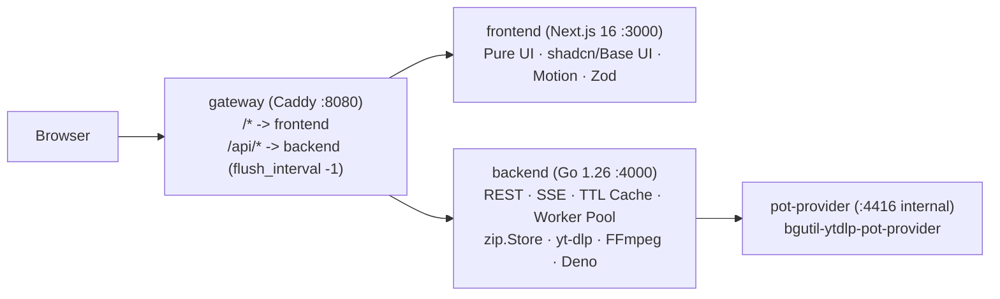

# Stash

High-speed, self-hosted YouTube video, audio, and selective playlist downloader.

Stash separates media extraction and streaming into a standalone **Go** API engine (`backend/`) and keeps the **Next.js 16** web client (`frontend/`) strictly UI-only. Both deploy together as a single **Docker Compose / Dokploy** application behind a lightweight unbuffered Caddy gateway (`gateway/`) with a bundled YouTube PO-token sidecar for VPS datacenter IPs.

---

## Features

- **Remux-first video pipeline**: Stream-copies matching YouTube tracks (`H.264/AAC` to `MP4` with `-movflags +faststart`, `VP9/AV1/Opus` to `MKV` or `WebM`) to avoid slow CPU re-encoding.
- **Native and lossless audio**: Fast stream-copy for `M4A` (AAC) and `Opus`, plus multi-threaded FFmpeg conversion for `MP3` (`320k` / `192k` / `128k`), `FLAC`, and `WAV`, with optional metadata and cover artwork embedding.
- **Fast selective playlist downloads**:
  - Resolves large playlists in seconds via `yt-dlp --flat-playlist` with a bounded in-memory TTL cache.
  - Virtualized tracklist (`@tanstack/react-virtual`) supporting instant search filtering, `Select All` / `Invert` / `Clear`, and `Shift + Click` contiguous range selection.
  - Bounded parallel Go worker pool (`1`–`4` concurrent tracks, multi-fragment downloading) with per-track **Server-Sent Events (SSE)** progress, single-track download, and single-track retry on failure.
  - Streams selected tracks directly into a single `.zip` using Go's `archive/zip` with `zip.Store` (zero DEFLATE CPU overhead on already-compressed media, zero duplicate zip disk usage).
- **VPS-ready anti-bot support**: Bundles the latest `yt-dlp`, **Deno** (JS challenge solver), `ffmpeg`, and `bgutil-ytdlp-pot-provider` in Docker Compose, plus optional read-only `cookies.txt` and proxy configuration.
- **Security hardened**: Strict YouTube host allowlist against SSRF, strict JSON unknown-field rejection (`DisallowUnknownFields`), zero-shell subprocess argument arrays (`--` before URLs), POSIX process-group cancellation (`Setpgid: true`), isolated per-job temp workspaces with automatic TTL cleanup, per-IP rate limiting, and CSP/security headers.

---

## Architecture



| Directory | Responsibility |
|---|---|
| `backend/` | Standalone Go HTTP API, YouTube inspection cache, parallel download orchestrator, SSE telemetry, `zip.Store` streamer, security validation |
| `frontend/` | Standalone Next.js 16 App Router client (zero `yt-dlp`, zero `ffmpeg`, zero media API routes) |
| `gateway/` | Minimal `caddy:2-alpine` reverse proxy uniting frontend and unbuffered streaming API under one origin |
| `DESIGN.md` | Visual identity, light/dark tokens, typography, and layout specification |
| `AGENTS.md` | Engineering conventions and architectural guardrails |

---

## Quick Start (Docker / Local)

Prerequisites: Docker (or Podman) with Compose support.

```bash
git clone https://github.com/adnansamirswe/yt-downloader-stash.git
cd yt-downloader-stash
docker compose -f docker-compose.yml -f docker-compose.local.yml up --build
```

Open `http://localhost:8080`.

---

## Deploying on Dokploy (VPS)

Stash is structured to run as a **single Docker Compose service** in Dokploy with no second API subdomain or build-time domain lock-in:

1. In Dokploy, create a new **Compose** service pointing to this repository (`docker-compose.yml`).
2. In the **Domains** tab, add your domain (for example, `stash.yourdomain.com`) mapped to service **`gateway`** on port **`8080`**.
3. Deploy. Dokploy's Traefik proxy handles TLS and forwards traffic to `gateway:8080`, which serves the Next.js UI at `/` and unbuffered SSE/file/ZIP streams from the Go backend at `/api/*`.

### Handling YouTube Bot Checks on Datacenter IPs

`docker-compose.yml` starts `brainicism/bgutil-ytdlp-pot-provider` automatically on the internal network (`http://pot-provider:4416`) so `yt-dlp` can mint Proof-of-Origin tokens.

If your VPS ASN still encounters YouTube age or bot verification prompts:
1. Mount a read-only Netscape-format `cookies.txt` file into the `backend` service (for example `/data/cookies.txt`) via Dokploy's Mounts tab.
2. Set `STASH_COOKIES_FILE=/data/cookies.txt` (and optionally `STASH_PROXY_URL`) in Dokploy's Environment tab and redeploy.

Never commit cookies files or `.env` files to Git.

---

## Local Development (Without Docker)

### Prerequisites
- **Go** `1.22+` (Go `1.26` toolchain auto-managed via `go.mod`)
- **Node.js** `22+` and `npm`
- **yt-dlp** (latest 2026 standalone binary recommended; `yt-dlp --version`)
- **FFmpeg** (`ffmpeg` and `ffprobe` in `PATH`)
- **Deno** (recommended default JS runtime for `yt-dlp`) or **Node.js** (auto-detected fallback)

### 1. Run the Go Backend

```bash
cd backend
cp .env.example .env   # Optional; configure via environment variables
go run ./cmd/server
```

The API listens on `http://localhost:4000`. Verify with:

```bash
curl http://localhost:4000/api/v1/health
```

### 2. Run the Next.js Frontend

```bash
cd frontend
npm install
NEXT_PUBLIC_API_URL=http://localhost:4000 npm run dev
```

Open `http://localhost:3000`.

---

## Configuration Reference

### Backend (`backend/.env.example`)

| Variable | Default | Description |
|---|---|---|
| `STASH_PORT` | `4000` | HTTP listen port |
| `STASH_ALLOWED_ORIGINS` | `http://localhost:3000,http://127.0.0.1:3000` | Comma-separated CORS allowlist (not needed for same-origin behind `gateway`) |
| `STASH_TEMP_DIR` | `/tmp/stash-jobs` | Isolated temporary download workspace directory |
| `STASH_MAX_CONCURRENT_JOBS` | `4` | Global concurrent download job cap |
| `STASH_MAX_CONCURRENT_TRACKS` | `4` | Max parallel track workers per playlist batch (`1`–`6`) |
| `STASH_FRAGMENTS_SINGLE` | `8` | `yt-dlp --concurrent-fragments` for single downloads |
| `STASH_FRAGMENTS_PLAYLIST` | `4` | `yt-dlp --concurrent-fragments` per track in parallel playlists |
| `STASH_MAX_PLAYLIST_ITEMS` | `200` | Maximum selected tracks accepted in a single playlist batch |
| `STASH_CACHE_TTL_SECONDS` | `600` | Metadata and flat-playlist inspection cache TTL |
| `STASH_JOB_TTL_MINUTES` | `30` | Retention period for completed temp files before automatic cleanup |
| `STASH_TRUST_PROXY` | `true` | Trust `X-Forwarded-For` / `X-Real-IP` for per-IP rate limiting |
| `STASH_INSPECT_RPM` | `60` | Per-IP `/api/v1/inspect` requests per minute |
| `STASH_JOB_RPM` | `30` | Per-IP `/api/v1/jobs/*` creation requests per minute |
| `STASH_YTDLP_BIN` | auto-detected | Override path to `yt-dlp` binary |
| `STASH_FFMPEG_BIN` | auto-detected | Override path to `ffmpeg` binary |
| `STASH_JS_RUNTIME` | auto-detected | Override `yt-dlp --js-runtimes` value (`deno` preferred, falls back to `node`) |
| `STASH_POT_PROVIDER_URL` | unset | URL of `bgutil-ytdlp-pot-provider` (set to `http://pot-provider:4416` in Compose) |
| `STASH_COOKIES_FILE` | unset | Path to read-only Netscape `cookies.txt` |
| `STASH_PROXY_URL` | unset | Optional HTTP/SOCKS proxy passed to `yt-dlp` |

### Frontend (`frontend/.env.example`)

| Variable | Default | Description |
|---|---|---|
| `NEXT_PUBLIC_API_URL` | `""` (same-origin) | Leave empty behind `gateway`; set to `http://localhost:4000` for standalone local dev or separate-subdomain deploys |

---

## API Overview (`/api/v1`)

| Method | Endpoint | Purpose |
|---|---|---|
| `GET` | `/api/v1/health` | Backend readiness, `yt-dlp` / `ffmpeg` versions, active JS runtime, PO-token status |
| `POST` | `/api/v1/inspect` | Inspect a YouTube video or playlist (`mode`: `auto` \| `video` \| `playlist`) |
| `POST` | `/api/v1/jobs/single` | Start a single video or audio download job |
| `POST` | `/api/v1/jobs/playlist` | Start a parallel selective playlist download job |
| `GET` | `/api/v1/jobs/{jobId}` | Fetch current job and per-track snapshot |
| `GET` | `/api/v1/jobs/{jobId}/events` | Stream live progress updates over Server-Sent Events (`text/event-stream`) |
| `POST` | `/api/v1/jobs/{jobId}/cancel` | Cancel an active job, terminate process groups, and delete temp files |
| `POST` | `/api/v1/jobs/{jobId}/tracks/{videoId}/retry` | Retry a single failed track inside a playlist job |
| `GET` | `/api/v1/jobs/{jobId}/download` | Stream finished media file or zero-compression playlist `.zip` |
| `GET` | `/api/v1/jobs/{jobId}/tracks/{videoId}/download` | Stream an individual completed track from a playlist job |

---

## Testing & Verification

```bash
# Backend checks and race-enabled tests
cd backend && go vet ./... && go test -race -v ./...

# Frontend typecheck, lint, and production build
cd frontend && npx tsc --noEmit && npm run lint && npm run build
```

---

## Contributing

Contributions, bug reports, and pull requests are welcome:

1. Read [`AGENTS.md`](./AGENTS.md) and [`DESIGN.md`](./DESIGN.md) before making architectural or UI changes.
2. Keep `frontend/` strictly UI-only and `backend/` responsible for all YouTube/FFmpeg execution and validation.
3. Run both the Go and Next.js verification commands above before opening a pull request.

---

## Responsible Use

Stash is intended for personal archival, offline viewing of content you have permission to download, Creative Commons / public domain media, and your own uploads. Respect copyright laws and YouTube's Terms of Service.

## License

No license file has been added yet. Add a `LICENSE` file (such as MIT or Apache-2.0) at the repository root to specify open-source licensing terms.
